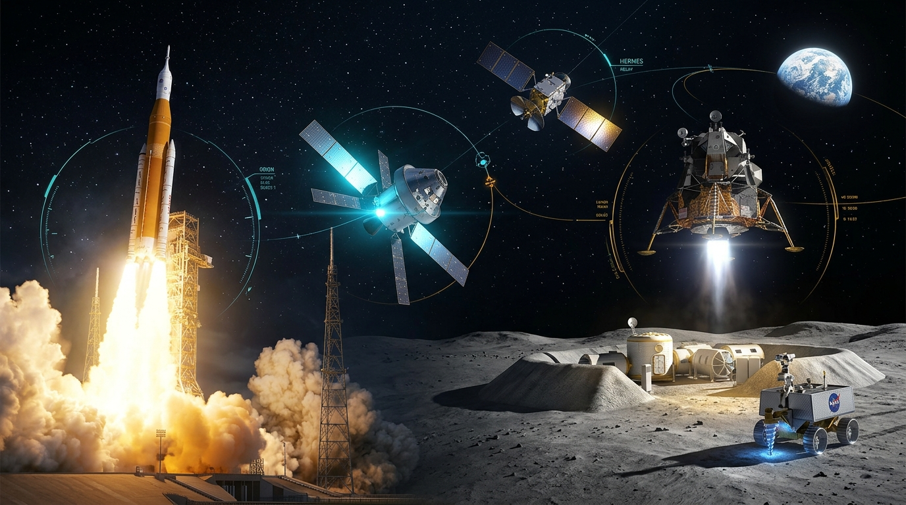
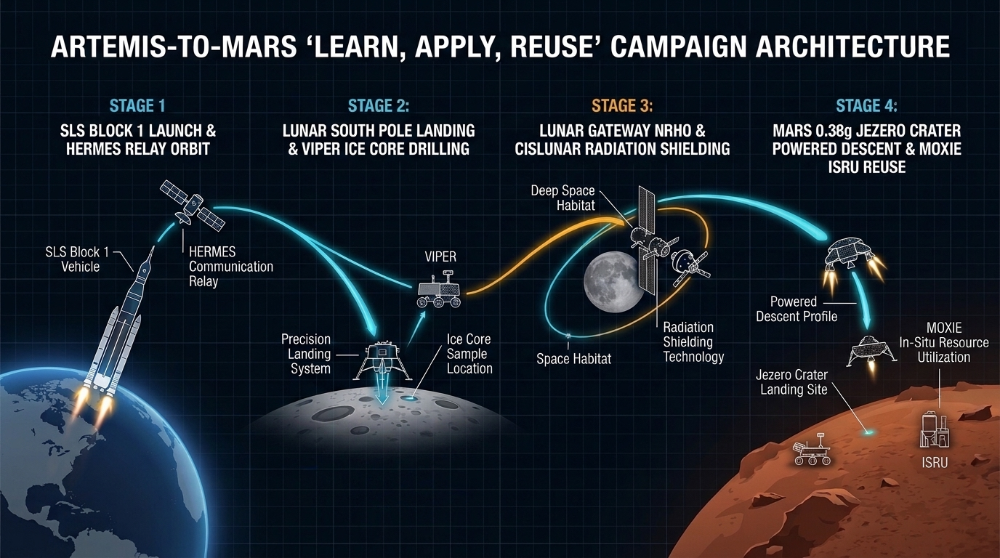
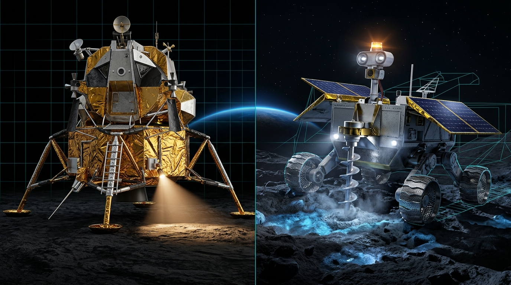

<div align="center">



# ARTEMIS ODYSSEY

### **Interactive 3D Moon-to-Mars Mission Trainer · NASA Space Apps Challenge**

_From Kennedy Space Center LC-39B to the Lunar South Pole, Gateway NRHO, and Mars Jezero Crater — learn real NASA engineering trade-offs, apply live space weather & radiobiology data, and reuse surface resources across a 4-mission campaign._

[](https://react.dev/)
[](https://www.typescriptlang.org/)
[](https://threejs.org/)
[](https://osdr.nasa.gov/)
[](#verified-engineering--test-suite)

</div>

---

## Why Artemis Odyssey Exists

Space exploration isn't a linear arcade game — it is a **systems-engineering puzzle** where every kilogram of shielding costs descent fuel, every solar storm tests crew radiation budgets, and every kilogram of polar water ice mined on the Moon directly enables humanity's next leap to Mars.

Most space apps either present static fact sheets _or_ disconnected mini-games. **Artemis Odyssey** unifies real **NASA Open Data (DONKI + OSDR)**, authentic **rocket-equation physics**, and **3D procedural spacecraft engineering** into a continuous **"Learn → Apply → Reuse"** training simulator built for students, mentors, and judges alike.

> _"Don't just read about Orion's water-wall shielding or lunar ISRU electrolysis — feel the extra 40% mass penalty on your descent engines during touchdown, then watch that exact water ice fuel your 0.38g Mars Jezero descent."_

---

## The 4-Stage "Learn → Apply → Reuse" Campaign

<p align="center">
  
</p>

Every phase feeds persistent engineering state (`CampaignCarryoverState`) forward into subsequent missions:

| Campaign Stage          | Planet / Orbit                              | Core Simulation Mechanics                                                                                                                                                             | Persistent Carryover ("Reuse")                                                                                     |
| :---------------------- | :------------------------------------------ | :------------------------------------------------------------------------------------------------------------------------------------------------------------------------------------ | :----------------------------------------------------------------------------------------------------------------- |
| **1 · Artemis II**      | Earth LC-39B → LLO (`365,000 km`)           | Manual T-0 SLS Block 1 launch, 3-stage separation (`45 km` SRB / `80 km` LAS / `110 km` Core), cislunar rendezvous & **HERMES Relay Satellite** zero-G wing unfold + laser dish lock. | Unlocks **High-Resolution Surface Contour Maps** & **+60s Solar Flare Early Warning**.                             |
| **2 · Artemis III**     | Moon South Pole (`0.165g` · `1.625 m/s²`)   | Pinpoint powered descent into **Pad Alpha**, **Shackleton Rim**, or **Malapert Ridge**, followed by **VIPER** 4-mode crater exploration & TRIDENT ice coring across `±138 m` terrain. | Mines **ISRU Water Ice → LH₂ Descent Fuel**, **Malapert Solar Grid kW**, and **OSDR Regolith Berm** (`-62%` dose). |
| **3 · Artemis IV**      | Lunar Gateway NRHO (`405,000 km`)           | Orbital navigation under live **NASA DONKI** solar particle alerts, shield boost power budgeting, and cryogenic fuel transfer at Gateway.                                             | Transfers **Lunar ISRU Propellant** & **Water-Tank Shielding Protocols** directly into the Mars fleet.             |
| **4 · Mars Pathfinder** | Mars Jezero Crater (`0.38g` · `3.721 m/s²`) | High-thrust **Quad-MLE** `0.38g` entry through mid-altitude Martian crosswind shear (`1.8–3.2 m/s`), Jezero delta coring, **MOXIE CO₂ Electrolysis**, and array dust management.      | Completes the **Moon-to-Mars Exploration Campaign** with full OSDR dose audit.                                     |

---

## Real NASA Open Data Integration (`server.ts`)

**Artemis Odyssey** runs a dedicated Express backend (`server.ts`) with a 6-hour in-memory cache serving real NASA telemetry into both the **Desktop 3D Cockpit** and the **Mobile Mission Academy**:

| Endpoint         | Source                                       | How Real NASA Data Drives Gameplay                                                                                                                                                                                                                                                                                                                                                              |
| :--------------- | :------------------------------------------- | :---------------------------------------------------------------------------------------------------------------------------------------------------------------------------------------------------------------------------------------------------------------------------------------------------------------------------------------------------------------------------------------------- |
| `GET /api/donki` | **NASA DONKI Space Weather API** (`FLR`)     | Queries the past 30 days of live solar flares. Active **M-Class / X-Class** flares dynamically expand the solar radiation belt radius in cislunar space (`32 → 48` units) and increase unshielded surface proton drain on Moon & Mars.                                                                                                                                                          |
| `GET /api/osdr`  | **NASA Open Science Data Repository (OSDR)** | Embeds verified radiobiology thresholds & attenuation ratios directly into anomaly choices and base mechanics: **OSD-569** _(MARE Water-Wall Vest, `-48%` SPE dose)_, **OSD-612** _(BioSentinel Deep-Space Yeast DNA break threshold `120 mSv`)_, **OSD-489** _(1.5 m Compacted Regolith Berm, `-62%` proton scatter)_, and **OSD-366** _(Mars MSL-RAD CO₂ & `-35%` dust-storm power penalty)_. |

---

## Custom 3D Fleet & Engineering Inspection

<p align="center">
  
</p>

Every spacecraft and surface outpost in `/src/three/models.ts` is built procedurally in Three.js with interactive subsystem inspection (`VehicleInspectorOverlay` + clickable LC-39B launch parts) and physics-synchronized animations:

- **SLS Block 1 Launch Vehicle & LC-39B Tower** — 65.1 m orange LH₂/LOX Core Stage with **4 RS-25 inner engine throats**, Twin 5-segment SRBs with live booster flame & separation kinematics, ICPS RL10 stage, Orion ESM stowed solar ribs + RCS pods, and **4 canted Launch Abort System (LAS)** nozzles above an animating umbilical crew access arm.
- **HERMES Space Weather & Relay Satellite** — Gold Kapton octagonal bus, magnetometer boom, twin articulated roll-out photovoltaic wings with hinge braces & end-caps, and central Ka-band laser dish supported by **3 tripod feed struts**.
- **Dual-Planet Descent Lander (Moon `0.165g` / Mars `0.38g`)** — Octagonal gold MLI descent stage, **4 articulated landing struts** with dynamic **telescoping Apollo Contact Probes** that visibly retract upon touchdown, **landing floodlight spotlight**, 4-axis lateral **RCS plume visualizers**, and a Mars-specific **Aeroshell Flange + 4 Canted Quad-MLE Engine Pods** (`marsTrim`) toggled automatically in `0.38g` Mars mode.
- **VIPER / Jezero Explorer Rover** — NASA meatball insignia decals, front/rear stereo hazcams, **spinning helical TRIDENT core auger**, under-chassis **Neutron Spectrometer**, pulsing **amber mast strobe beacon**, **dust-reactive solar wing materials** in Mars storms, and real **Walker gait kinematics** across `±138 m` crater corridors.
- **Artemis & Mars Base Camp Outpost** — Geodesic crew dome protected by a **Compacted Regolith Radiation Berm Arc (`OSD-489`)**, sunlit solar towers, Deep-Space Dish, glowing sintered landing pad, and an exterior **ISRU / MOXIE Cryo Manifold Skid**.

---

## Precision Flight Systems & Responsive Design

### 1. Real-Time Powered Descent Computer (`stepLandingPhysics`)

Landing is engineered like a true NASA guidance console — **never** a floating toy:

- **Sticky Pintle Throttle & TWR Gauge**: Engine chamber pressure holds set throttle cleanly (`W`/`Z` or `-5%` / `+5%` HUD buttons), alongside live **Thrust-to-Weight Ratio (`TWR`)** and **Hover Balance (`Hover %`)** readout.
- **3 Guidance Modes**: Full **Manual**, **Rate Assist** (automatic vertical sink profile + horizontal velocity damping), and **AUTOLAND [G]** (predictive Apollo E-Guidance / Mars G-FOLD controller mathematically verified across **all 6 Moon & Mars landing zones**, even carrying the `+40%` MARE Shield Vest mass penalty).
- **4-Axis Lateral RCS Kill Drift `[B]`**: Fires port/starboard/fore/aft cold-gas thrusters to zero horizontal drift rapidly before touchdown.
- **Apollo Contact Light Auto-Cutoff `[K]`**: Illuminates the blue `CONTACT` probe indicator at `<= 1.75 m` above terrain and executes clean engine shutdown to prevent bounce-over.
- **Live Pad Radar & Hazard Sensing**: Displays **Predicted Touchdown Reticle** (`predX, predZ`), **Predicted Terrain Slope (`°`)**, **Time-to-Go (`T-Go`)**, Mars crosswind shear (`m/s`), and **4 dynamic sky Approach Gates** aligned to the currently selected pad corridor.
- **Top-of-HUD Mission Progress Bar & Rover Speedometer**: Continuous distance/altitude remaining bar across all 4 phases plus a live center-bottom **VIPER Speedometer (`m/s`, `km/h`, Gear State `FWD / REV / PIVOT / HOLD`)**.

### 2. Responsive Mobile Academy Mode (`< 1024px`)

Because real-time 3D WebGL flight (`WASD` + `360°` mouse orbit + pintle feathering) requires a Desktop screen, opening **Artemis Odyssey** on a smartphone or narrow tablet automatically routes into the **Mobile Mission Academy** (`MobileAcademyView.tsx`):

- **Locks out the 3D WebGL simulation** (`SpaceSceneManager` is not mounted on mobile) with a clear **Desktop Required (1024px+)** notice and one-tap **Copy Link for Desktop** button.
- **Zero Pause in Education**: Mobile visitors get a complete, interactive 4-tab Aerospace Academy (**Missions & Rocket Equation**, **5-Craft Hardware Blueprints**, **Interactive OSDR Anomaly Simulator**, and **Live NASA DONKI & Field Notes Ledger**).

---

## Flight & Surface Controls Cheat-Sheet

| Phase                  | Key / Control            | Action                                                              |
| :--------------------- | :----------------------- | :------------------------------------------------------------------ |
| **Launch (`SLS`)**     | `W` / `↑`                | Ignite RS-25 + SRBs at T-0 _(strictly waits for astronaut command)_ |
|                        | `SPACE`                  | Jettison SRBs at `45 km` & Core Stage at `110 km`                   |
|                        | `Click 3D Rocket`        | Inspect individual SLS / Orion / LC-39B hardware systems            |
| **Space (`Orion`)**    | `W / A / S / D`          | Thrust & steer across Cislunar / Mars transfer                      |
|                        | `SHIFT` / `G`            | High-Impulse Burn / Auto-Pilot to active target                     |
|                        | `Hold E / SPACE`         | Deploy **HERMES Relay**, unfold PV wings & lock Ka-band link        |
| **Descent (`Lander`)** | `W` / `Z` · `H` · `X`    | Pintle Throttle Up/Down · Match Hover Balance · Engine Cutoff       |
|                        | `A / D / S / Q`          | Roll & Pitch Attitude (`±26°` / `±22°`) + Lateral Translation       |
|                        | `B` / `K` / `G`          | **Kill Drift RCS** · **Contact Auto-Cut** · **Auto-Land**           |
|                        | `1 / 2 / 3` · `C`        | Target Pad Alpha / Zone Bravo / Zone Charlie · Cycle Camera         |
| **Surface (`VIPER`)**  | `W / A / S / D`          | Drive & steer across Moon (`0.165g`) or Mars (`0.38g`) craters      |
|                        | `1 / 2 / 3 / 4`          | Switch Drive Mode: **Ackermann / Crab / Spin / Walker Gait**        |
|                        | `F` / `L` / `Hold SPACE` | High Clearance Lift · Headlights · Spin Helical TRIDENT Drill       |
|                        | `TAB` / `Drag + Wheel`   | Toggle High-Res Surface Map · Universal 360° Camera Orbit & Zoom    |

---

## System Architecture

```text
Artemis-Odyssey/
├── server.ts                          # Express + Vite middleware + 6h cached /api/donki & /api/osdr
├── docs/images/                       # Hackathon renders & campaign architecture diagrams
└── src/
    ├── App.tsx                        # Responsive Desktop (3D) vs Mobile Academy router & loop
    ├── game/
    │   ├── constants.ts               # Verified NASA physics, payloads, 4 missions, OSDR notes
    │   ├── types.ts                   # Strict TypeScript state contracts
    │   ├── physics.ts                 # Decoupled pure Launch, Space, Landing, and Rover physics
    │   ├── missionProgress.ts         # Top-bar milestone telemetry & Rover Speedometer math
    │   ├── physics.test.ts            # Unit tests: SLS staging, space autopilot, 6-zone AUTOLAND, RCS
    │   ├── missionProgress.test.ts    # Unit tests: launch/space/landing/rover progress & gears
    │   └── audio.ts                   # Procedural Web Audio synthesizer (ignition, drill, chimes)
    ├── three/
    │   ├── models.ts                  # Procedural 3D SLS, Orion, HERMES, Dual-Planet Lander, VIPER, Outpost
    │   ├── textures.ts                # Procedural Moon/Mars bump maps, NASA insignia & solar grid textures
    │   └── SpaceSceneManager.ts       # WebGL lifecycle, dynamic approach gates, 4-axis RCS & terrain collision
    └── components/
        ├── TitleOverlay.tsx           # Mission Manifest, 3D showcase switcher, quick-stage launchpad
        ├── VehicleInspectorOverlay.tsx# 5-craft 3D engineering inspection console
        ├── BriefingOverlay.tsx        # Rocket-equation payload selector & DONKI/OSDR mission brief
        ├── LaunchHUD.tsx              # Countdown, staging indicators, telemetry & interactive part picker
        ├── SpaceFlightHUD.tsx         # Solar radar, HERMES calibration & OSDR storm anomaly decisions
        ├── LandingHUD.tsx             # Pintle throttle bar, TWR, Slope/T-Go, Pad Radar & E-Guidance
        ├── RoverHUD.tsx               # 4-mode drive deck, TRIDENT drill progress, Surface Map & Speedometer
        ├── MissionProgressBar.tsx     # Unified top-of-HUD mission progress & milestone visualizer
        ├── RoverSpeedometer.tsx       # Center-bottom Moonwalker/Mars rover speed & gear dial
        └── MobileAcademyView.tsx      # Responsive mobile educational briefing & anomaly trainer (<1024px)
```

---

## Quickstart & Local Development

### Prerequisites

- **Node.js `20+`** (recommended `22.x`) and `npm`

### Run Locally

```bash
# 1. Install dependencies
npm install

# 2. Optional: configure environment variables (DONKI uses DEMO_KEY automatically)
cp .env.example .env

# 3. Start Express + Vite dev server on http://localhost:3000
npm run dev
```

Open **`http://localhost:3000`** on a **Desktop browser (`≥ 1024px`)** for the full 3D flight simulator, or resize below `1024px` / open on a **smartphone** to explore the **Mobile Mission Academy**.

> **Direct Stage Launch**: Append `?autostart=1` (`http://localhost:3000/?autostart=1`) on desktop to jump straight onto LC-39B for instant flight demos.

### Soundtrack & Custom Audio Configuration

Artemis Odyssey features an authentic physical rocket acoustics and cockpit SFX engine powered by the Web Audio API. Background music is strictly separated from SFX:

- The Web Audio synthesizer generates real-time procedural physics effects (engine sub-bass rumble, SRB crackle, aerodynamic boundary-layer buffeting, Apollo 1202 alarms, and telemetry chatter). It **never** generates artificial background music tones.
- Background soundtracks are licensed under the Pixabay Content License and are not tracked in the git repository:
  - `public/assets/audio/music/title_theme.mp3`: Main Menu / Title Screen soundtrack (Candidate: _Space Ambient Cinematic_ by Tunetank).
  - `public/assets/audio/music/space_flight_theme.mp3`: In-flight deep space and orbital soundtrack (_Space Ambient Cinematic Music_ by Viacheslav Starostin, Track ID 338203).
- **Silent Fallback**: If these MP3 files are absent, the application gracefully remains completely silent for background music without interrupting gameplay or playing placeholder tones.
- **Adding Your Own Soundtrack**: Place your MP3 files directly into `public/assets/audio/music/` (or `public/audio/`). Both paths are gitignored to preserve clean repo hygiene.
- **Content ID Notice**: Some stock music tracks have digital audio fingerprints registered with YouTube Content ID for automated rights tracking. Gameplay streamers and video creators can clear automated claims by downloading the Pixabay license certificate.

---

## Verified Engineering & Test Suite

All core physics laws, guidance autopilots, progress readouts, and TypeScript contracts are continuously verified with automated `node:test` suites (`tsx --test`) and static checks:

```bash
# Run all 13 physics & telemetry unit tests
npx --yes tsx --test src/game/missionProgress.test.ts src/game/physics.test.ts

# TypeScript strict check
npm run lint

# Production bundle build
npm run build
```

| Test Module                            | Verified Capabilities                                                                                                                                                                                                                                                                                                                                                                                                                                                                                                                                                                                                                                                                                          |
| :------------------------------------- | :------------------------------------------------------------------------------------------------------------------------------------------------------------------------------------------------------------------------------------------------------------------------------------------------------------------------------------------------------------------------------------------------------------------------------------------------------------------------------------------------------------------------------------------------------------------------------------------------------------------------------------------------------------------------------------------------------------- |
| **`src/game/physics.test.ts`**         | • SLS Launch waits at `READY` without auto-launch, ignites on command, stages at `45 km` & `110 km`, reaches `165 km` orbit<br>• HERMES satellite unfolds PV wings & locks telemetry in zero-G without landing<br>• Space Autopilot enters zero-fuel station-keeping upon arrival at HERMES, Moon, or Mars<br>• `AUTOLAND` achieves `perfect` touchdown within `≤ 8.5 m` of pad center across **all 6 Moon & Mars zones** with heavy `1.4x` MARE Shield cargo<br>• `RATE_ASSIST` horizontal damping, `Kill Drift [B]` RCS braking, `Contact Light Auto-Cut [K]`, and `getSurfaceSlopeDeg` hazard math<br>• VIPER `±138 m` terrain bounds, Mars dust accumulation, and OSDR regolith berm radiation attenuation |
| **`src/game/missionProgress.test.ts`** | • Launch `0 → 165.0 km`, Space leg sim-km countdown, rounded integer Landing entry altitude (`165 m` / `173 m`), Rover coring site progress, and real-time `m/s` / `km/h` Speedometer gear telemetry                                                                                                                                                                                                                                                                                                                                                                                                                                                                                                           |

---

<div align="center">

**Built for the NASA Space Apps Challenge** · _Ad Astra Per Scientiam — Moon to Mars_

</div>
